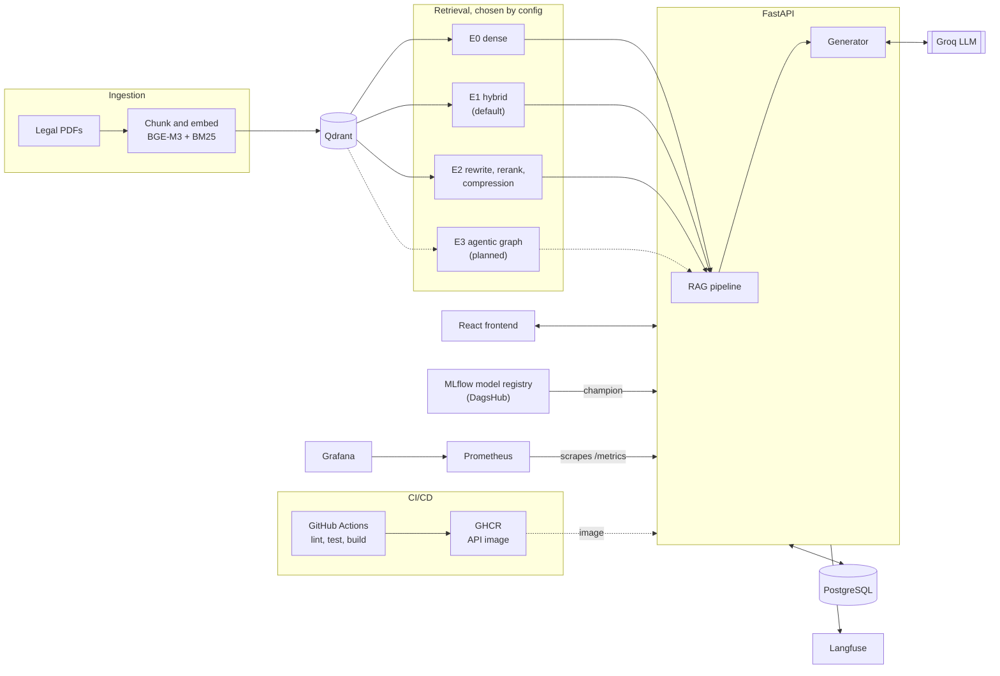

# LegalEase-RAG

[](https://github.com/Mohamed-G11/leagal-ease/actions/workflows/ci.yml?query=branch%3Amain)

A retrieval-augmented assistant for Tunisian legal texts and administrative procedures (startup creation, RNE,
CNSS). It answers in French, English, Arabic or Tunisian Darija **from the indexed documents, with the sources
cited**, and says so when the documents do not contain the answer. It gives legal information, not legal advice.

University capstone project, AI Engineering course.

## Features

- **Cited answers.** Each answer lists its sources (document, page, quoted passage), and abstains rather than guess.
- **Retrieval experiments** selected by config: E0 dense, E1 hybrid (dense + BM25, the default), E2 advanced
  (query rewriting, reranking, compression). E3 (agentic graph) is planned.
- **Chat widget** with citations, a confidence line, thumbs up/down and conversation history. A separate welcome bot
  answers visitors who have no account.
- **Procedure tracking:** step-by-step timelines, deadlines and reminders, document uploads, teammates, admin pages.
- **Model registry:** the API serves the `champion` pipeline from MLflow and switches without a redeploy.
- **MCP server:** the corpus as tools for any MCP client (demo with the MCP Inspector).
- **Operations:** request log, user feedback, Prometheus metrics, Grafana dashboard, Langfuse traces, CI and image
  publishing.

## Architecture



Dashed lines are planned (E3) or manual (nothing deploys the published image).

## Quick start

You need Docker, about 8 GB of free disk space, a [Groq API key](https://console.groq.com) and the PDF documents
to index (they are not in the repository).

```bash
cp .env.example .env        # set SECRET_KEY, GROQ_API_KEY and the PostgreSQL password (see Configuration)
docker compose up -d --build
```

| What | Address |
|---|---|
| Web app | `http://localhost:5173` |
| API and Swagger UI | `http://localhost:8000/docs` |
| Health | `http://localhost:8000/health` |
| Prometheus | `http://localhost:9090` |
| Grafana | `http://localhost:3000` (needs `GRAFANA_ADMIN_PASSWORD`) |

Every port is bound to `127.0.0.1`: other machines on the network cannot reach the services.

### First start

1. **Build.** Building the images takes about 10 minutes the first time.
2. **Model download.** The embedding model (BGE-M3, about 2.3 GB) is downloaded into the `hf_cache` volume. Until it
   is there, `/health` says `"pipeline": "loading"` (about 15 minutes on our connection; later starts take under a
   minute). Follow it with `docker compose logs -f api`.
3. **Migrations** are applied automatically each time the API container starts.
4. **Ingestion.** Put the PDFs in `data/raw/` and index them into the Docker Qdrant, once:

   ```bash
   docker compose run --rm --no-deps -v "${PWD}/data/raw:/srv/data/raw:ro" api \
     python -m app.ingestion.temp_ingest --pdf-dir /srv/data/raw --config /srv/experiments/E1_hybrid_rag/config.yaml
   ```

   (PowerShell: put it on one line. Git Bash: prefix it with `MSYS_NO_PATHCONV=1`.) **This replaces the collection**
   named in the config. Until it exists, `/health` says `"qdrant": "empty"` and the chat returns HTTP 503.
5. **Account.** Sign up in the web app. Optional:

   ```bash
   docker compose exec api python -m scripts.seed_procedure          # procedure templates for the timeline
   docker compose exec api python -m scripts.make_admin <username>   # admin rights
   ```

`/health` should then report `"status": "ok"`.

## Configuration

Everything is read from `.env` at run time; it is never committed or copied into an image. Compose replaces
`DATABASE_URL` and `QDRANT_URL` with the container addresses, so those two only matter when running from source.

| Variable | Needed | Meaning |
|---|---|---|
| `POSTGRES_USER`, `POSTGRES_PASSWORD`, `POSTGRES_DB` | yes | Credentials and database of the PostgreSQL container |
| `DATABASE_URL` | from source | Must start with `postgresql+psycopg2://`, host port **5433** |
| `QDRANT_URL` | from source | `http://localhost:6333`. Empty means a local `qdrant_local/` folder |
| `SECRET_KEY` | yes | Signs the login tokens. Use a long random value |
| `ALGORITHM`, `ACCESS_TOKEN_EXPIRE_MINUTES` | no | Token signature (`HS256`) and lifetime (30 minutes) |
| `GROQ_API_KEY` | yes | LLM calls |
| `RAG_CONFIG` | no | Experiment config served, default `experiments/E1_hybrid_rag/config.yaml` |
| `RESEND_API_KEY`, `RESEND_FROM_EMAIL` | no | Deadline reminder emails |
| `MLFLOW_TRACKING_URI` | no | Model registry (DagsHub: `https://dagshub.com/<user>/<repo>.mlflow`). Empty serves `RAG_CONFIG` |
| `MLFLOW_TRACKING_USERNAME`, `MLFLOW_TRACKING_PASSWORD` | with the registry | DagsHub user name and access token |
| `LANGFUSE_PUBLIC_KEY`, `LANGFUSE_SECRET_KEY` | no | Tracing is on only when both are set |
| `LANGFUSE_BASE_URL` | no | Langfuse region or server shown with your keys |
| `LANGFUSE_CAPTURE_TEXT` | no | `true` also sends question, answer and prompt text to Langfuse |
| `GRAFANA_ADMIN_PASSWORD` | for Grafana | Password of the `admin` user, stored at Grafana's first start |
| `FRONTEND_PORT` | no | Host port of the web app, default 5173 |
| `VITE_API_URL` | no | API address for the frontend when it is built from source (see Known limitations) |

## Using the API

Swagger UI is at `http://localhost:8000/docs`. The chat endpoints need a login token.

- `POST /api/v1/chat` returns the whole answer as JSON, with citations (used by the chat widget). Each citation has
  a `number`: the `[n]` that refers to it in the answer text, or `null` when unknown.
- `POST /api/v1/ai/chat/stream` sends the answer as server-sent events.
- `POST /api/v1/ai/feedback` rates an answer: send `rating` (`up` or `down`) and the `message_id` of the answer.
- `POST /api/v1/ai/chat/public` is the welcome bot: no login, 10 requests per minute per address.

Follow-up questions work within a conversation: its last messages (`llm.max_history_messages` in the served config,
6 by default) are sent to the model as context, without failed exchanges and without the `[n]` markers of past
answers. Facts must still come from the retrieved sources. The `history` field of the stream endpoint is ignored.
Until the pipeline and the index are ready, the chat returns HTTP 503.

### Which model is served

With `MLFLOW_TRACKING_URI` set, the API serves the version of `legalease-rag` that has the `champion` alias in the
MLflow Model Registry (see [docs/README_REGISTRY.md](docs/README_REGISTRY.md)). It serves the `RAG_CONFIG` file
instead when the variable is empty, the registry is unreachable, there is no champion, or the model cannot be loaded.
`/health` says which: `"model": {"source": "registry", "version": "3", "config": "E1_hybrid_rag"}`.

After moving the alias, switch the running API with an admin token (no restart or redeploy):

```bash
curl -X POST http://localhost:8000/api/v1/admin/rag/reload -H "Authorization: Bearer <admin token>"
```

- If the new champion cannot be loaded, the current model keeps serving and `message` says why.
- A registry model runs the code it contains: give write access to the registry only to people you trust.
- The API runs its own `app` code, so a new version changes the experiment config, not the code.
- The new version's collection must already be indexed in Qdrant.

## MCP server

The corpus is also available as [Model Context Protocol](https://modelcontextprotocol.io) tools, for the MCP
Inspector or any MCP client.

| Tool | Returns | Limits | Calls Groq |
|---|---|---|---|
| `search_legal_texts(query, k, lang?)` | passages with document, page and score | `k` 1–10, query ≤ 1000 characters | E2 only |
| `ask_legal_question(question)` | answer, cited sources, confidence | ≤ 4000 characters, 10 per minute | yes |
| `get_document_page(doc_id, page)` | the indexed passages of one page | one page per call | no |
| `list_documents()` | documents with ids, languages and page counts | none | no |

With E1 (the default) `score` is a reciprocal rank fusion score: it ranks passages and is not a similarity.
`lang` is `fr`, `ar` or `en`.

The server loads its own pipeline, like the API (registry champion, else `RAG_CONFIG`), so it uses its own memory
(about 900 MB) and does not need the API. It connects at once and loads the model in the background: until it is
ready, tools answer "still loading, retry". A model switch (`/admin/rag/reload`) does not reach it: restart it.

### Before you start

- The project installed as in "Running from source", and `.env` filled in, with `QDRANT_URL=http://localhost:6333`
  and `GROQ_API_KEY`. The server reads `.env` itself: **no client configuration needs a key.**
- The **Qdrant server** with the index (`docker compose up -d qdrant postgres`). A local index is never used.
- For the Inspector: Node.js 22.23.4+ or 24.22.1+.

### Demo with the MCP Inspector

**Over stdio** (the Inspector starts the server). From the repository root:

```bash
npx @modelcontextprotocol/inspector@2.17.0 .venv/Scripts/python.exe backend/scripts/run_mcp.py
# Linux / macOS: .venv/bin/python
```

Open the address it prints, connect the server, open **Tools**, pick a tool, fill in its fields and press **Execute
Tool**. In the first half minute or so the answer is "still loading": execute again.

**Over streamable HTTP** (a compose service, off by default):

```bash
docker compose --profile mcp up -d --build mcp        # http://127.0.0.1:8001/mcp
npx @modelcontextprotocol/inspector@2.17.0 --transport http --server-url http://127.0.0.1:8001/mcp
```

Or from the command line:

```bash
I="npx @modelcontextprotocol/inspector@2.17.0 --cli http://127.0.0.1:8001/mcp"
$I --method tools/list
$I --method tools/call --tool-name list_documents
$I --method tools/call --tool-name search_legal_texts --tool-arg "query=durée du label Startup" k=3 lang=fr
$I --method tools/call --tool-name get_document_page --tool-arg doc_id=article_la_startup_en_droit_tunisien page=2
$I --method tools/call --tool-name ask_legal_question --tool-arg "question=Quelle est la durée du label Startup ?"
```

The command line only calls tools over HTTP: over stdio each command starts a new server, which is still loading.

The HTTP service has **no login** and is bound to `127.0.0.1`. Do not expose it. Without Docker:
`python backend/scripts/run_mcp.py --http`. Stop it with `docker compose --profile mcp stop mcp`.

### Smoke test

```bash
python backend/scripts/mcp_client.py      # starts the server over stdio and calls each tool once
```

It exits with 1 if a tool fails. The test suite runs the same script against a fake server
(`backend/tests/mcp_fake_server.py`), so CI needs no model, Groq or Qdrant.

### LangChain and LangGraph

The tools load with [`langchain-mcp-adapters`](https://github.com/langchain-ai/langchain-mcp-adapters), which is **not**
a dependency of this project. Its 0.3.2 release needs `mcp<2` while the server uses `mcp` 2.x, so the client must have
**its own virtual environment** (checked with 0.3.2, `mcp` 1.30.0, `langchain-core` 1.8.5):

Until the team decides how E3 uses these tools: `langchain-mcp-adapters` 0.3.x requires `mcp<2`, so use a separate
environment and connect over HTTP.

```python
from langchain_mcp_adapters.client import MultiServerMCPClient
from langchain_mcp_adapters.tools import load_mcp_tools

client = MultiServerMCPClient({"legalease": {"transport": "streamable_http", "url": "http://127.0.0.1:8001/mcp"}})

async with client.session("legalease") as session:   # one session for the whole agent run
    tools = await load_mcp_tools(session)
```

Use a session, especially over stdio: without one each tool call starts a new server and reloads the model. A tool
that fails (for example "still loading") returns the error as its text.

### Claude Desktop (optional)

In `claude_desktop_config.json`, with absolute paths and no key:

```json
{
  "mcpServers": {
    "legalease": {
      "command": "C:\\path\\to\\LegalEase-RAG\\.venv\\Scripts\\python.exe",
      "args": ["C:\\path\\to\\LegalEase-RAG\\backend\\scripts\\run_mcp.py"],
      "cwd": "C:\\path\\to\\LegalEase-RAG"
    }
  }
}
```

Restart Claude Desktop. This was not tested with Claude Desktop itself.

### What is recorded

`search_legal_texts` and `ask_legal_question` write a row in `ai_query_logs` (`endpoint` `mcp_search` or `mcp_ask`)
with the question, language, status and latency, and nothing about who asked. These rows are left out of the admin
answer rate and unanswered questions. If PostgreSQL is off or not migrated (`alembic upgrade head`), the tools still
work and the server log says so. With Langfuse keys, timings and token counts are traced, **never the text**, whatever
`LANGFUSE_CAPTURE_TEXT` says. MCP calls are not in the Prometheus metrics.

## Monitoring and observability

### Prometheus and Grafana

| Service | Address | Notes |
|---|---|---|
| Metrics | `http://localhost:8000/metrics` | Served by the API |
| Prometheus | `http://localhost:9090` | Scrapes the API every 15 s |
| Grafana | `http://localhost:3000` | User `admin`. Dashboard "LegalEase API" in the LegalEase folder |

- The datasource and dashboard are provisioned from `monitoring/`. Edit the files, not the Grafana UI.
- Grafana does not start without `GRAFANA_ADMIN_PASSWORD`, and keeps the password of its first start.
- Chat metrics: `legalease_chat_requests_total{outcome="answered|abstained|error"}` and
  `legalease_chat_duration_seconds`. The public bot is not counted.
- CPU and memory are those of the API process only.
- `/metrics` has **no authentication**. Do not expose port 8000 to the internet without blocking that path.

### Langfuse traces

With both keys set, each `/chat` and `/chat/stream` request is one trace named `chat`, grouped by conversation:
`retrieval` (chunk ids and scores, containing `query_rewrite` and `reranking` when used) and `generation` (model and
token counts), plus status, number of citations, message id and served model. Costs appear when the model has a price
in your Langfuse project. The public bot is traced as `chat_public` with status, duration and token counts only.
A Langfuse failure never fails a chat request.

**Text is not sent by default.** `LANGFUSE_CAPTURE_TEXT=true` adds question, answer and prompt, which includes the
earlier messages of the conversation (never for the public bot). Deleting a conversation in the app does **not**
erase it from Langfuse.

### Request log and privacy

Every chat request writes one row in `ai_query_logs`: question, language, status, latency, citations, verified
citations (quotes found in the cited passage), reranker score (E2 and later) and `message_id`. Feedback rows in
`ai_feedback` carry the same `message_id`:

```sql
SELECT l.question, l.status, l.latency_ms, f.rating
FROM ai_query_logs l LEFT JOIN ai_feedback f ON f.message_id = l.message_id;
```

- The public bot logs question, language, status and latency only: no IP address or visitor identifier.
- The admin answer rate and unanswered-questions list leave out public and MCP rows.
- Deleting a conversation erases the question text from its log rows and the question and answer text from its
  feedback rows. Ratings and numeric fields stay.
- SQL statements are not echoed, and database errors hide query parameters.

## Running from source

Python 3.11, Node.js 20.19+ or 22.13+, Docker for PostgreSQL and Qdrant.

```bash
py -3.11 -m venv .venv              # Linux / macOS: python3.11 -m venv .venv
.venv\Scripts\activate              # Linux / macOS: source .venv/bin/activate
pip install -r requirements-dev.txt
cp .env.example .env                # then edit the values

docker compose up -d postgres qdrant
cd backend
alembic upgrade head                # also after every pull
uvicorn app.main:app --reload
```

In another terminal:

```bash
cd frontend
npm ci
npm run dev                         # http://localhost:5173
```

To index from your machine instead of a container (the command does not read `.env`):

```bash
cd backend
export QDRANT_URL=http://localhost:6333      # PowerShell: $env:QDRANT_URL = "http://localhost:6333"
python -m app.ingestion.temp_ingest --pdf-dir ../data/raw --config ../experiments/E1_hybrid_rag/config.yaml
```

The index must be in the server the API uses: one built in local mode (`qdrant_local/`) is not visible to it.

## Tests and checks

```bash
ruff check .                        # from the repo root
pytest                              # from the repo root: SQLite and fakes, no Groq, registry or Langfuse calls
cd frontend && npm run lint && npm run build
```

CI (`.github/workflows/ci.yml`) runs these on every pull request, plus the migrations on PostgreSQL (upgrade,
downgrade, upgrade, and a check that models and migrations agree). The frontend has no automated tests.

### Published image

Every push to `main` builds the API image and publishes it to GitHub Container Registry
(`.github/workflows/cd.yml`), tagged with the commit SHA and `latest`. Nothing is deployed.

```bash
docker pull ghcr.io/mohamed-g11/leagal-ease-api:latest
```

### Dependencies

- `requirements.txt`: pinned runtime dependencies. `requirements-dev.txt` adds pytest, httpx and ruff.
- `requirements-mlops.txt`: adds Prefect, RAGAS and Evidently for offline tools. CI and the API image skip it.
- `requirements.lock`: full `pip freeze` of the dev environment.

PyTorch installs as the CPU build. For a local GPU, replace it after the normal install (and do not commit the change):

```bash
pip install torch==2.14.1 --index-url https://download.pytorch.org/whl/cu126 --force-reinstall --no-deps
```

## Team

| Member | Area |
|---|---|
| Wiem | Retrieval, agents, MLflow, model registry, Prefect |
| Hend | Data, DVC, RAGAS, Evidently |
| Mohamed | Platform, CI/CD, monitoring |

Not in the repository yet: the E3 agentic graph, Prefect flows, DVC data versioning, RAGAS evaluation and Evidently
reports (their packages are pinned).

Component notes: [E0](docs/README_E0.md), [E1](docs/README_E1.md), [E2](docs/README_E2.md),
[model registry](docs/README_REGISTRY.md).

## Links

- DagsHub (experiments and model registry): _to be added_
- Prefect: _to be added_
- Grafana: _to be added_ (local: `http://localhost:3000`)

## Known limitations

**Answers**
- The answer's `[n]` markers are not part of the shared `Citation` schema. The API derives each citation's number from
  the order of the retrieved chunks, which holds for the current pipeline; a pipeline that retrieves differently
  (such as a future E3) would give citations without a number, and the widget then removes the markers.
- The confidence shown measures whether the quotes are found in the cited passages, not whether those passages
  answer the question: a wrong answer can show 100%. It is an indicator, not a probability.
- `verified_citations_count` and the confidence can overstate: when the model gives no quote, `parse_answer` uses the
  first 200 characters of the chunk, which always matches. Reported to its author.
- With E1 (the default), a follow-up question is searched as typed ("and for an SARL?"), so retrieval may miss; only
  E2 rewrites it using the conversation.
- A short French follow-up question can be answered in English: the language is guessed from the question alone.
  Reported to Wiem.
- Documents can state different durations for related rules (for example the Startup label); the answer then depends
  on which passage is retrieved. Check the cited source.
- The public welcome bot is not grounded in the documents.

**E2 (advanced retrieval)**
- The reranker is slow on CPU.

**Privacy and security**
- The web server's access log records IP addresses (the database does not).
- A PostgreSQL error message can quote a rejected row, including question text.
- `/metrics` is not authenticated.
- Anything sent to Langfuse is not erased when a conversation is deleted.

**Platform**
- The chat widget and the welcome bot call `http://127.0.0.1:8000`, whatever `VITE_API_URL` says: the web app only
  works on the machine that runs the API.
- One API process: the rate limit and the loaded model are per process.
- With Qdrant in local mode (no `QDRANT_URL`), the served model cannot be switched without a restart.
- Ratings given earlier are not shown again when a conversation is reopened.
